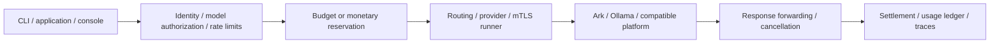

<p align="center">
  
</p>

<h1 align="center">AgentMesh</h1>

<p align="center"><strong>One model gateway. Routed, budgeted, and traceable.</strong></p>

<p align="center">A multi-tenant LLM gateway and Agent Runtime, built with Go, MySQL, Redis, and Kafka.</p>

<p align="center">
  <a href="https://github.com/17hwliao/AgentMesh/tree/master"></a>
  <a href="go.mod"></a>
  <a href="#project-license"></a>
</p>

<p align="center">
  <a href="#capabilities">Capabilities</a> &nbsp;·&nbsp;
  <a href="#quick-start">Quick start</a> &nbsp;·&nbsp;
  <a href="#deployment">Deployment</a> &nbsp;·&nbsp;
  <a href="#documentation">Documentation</a>
</p>

---

AgentMesh provides a shared model service for AI applications. It handles provider integration, streaming, tenant identity, routing, budgets, and telemetry through a public HTTP contract. SQL Sentinel and the document-summary CLI use the same gateway while keeping their own workflows.

| Connect | Control | Observe |
| :--- | :--- | :--- |
| Ark, Ollama, and OpenAI-compatible providers, with model discovery and client adapters. | Tenant keys, model routes, rate limits, budget reservations, and an optional RMB wallet. | Request traces, usage projections, billing references, Prometheus, and OpenTelemetry. |

## Capabilities

| Area | Implementation and guide |
| :--- | :--- |
| **Models and clients** | Streaming and non-streaming Chat, tool calls, and Messages conversion. [OpenCode / Claude Code integration](docs/client-integration.md). |
| **Tenants and identity** | MySQL-backed tenants, key lifecycle management, and model authorization. [Accounts and private images](docs/account-images.md). |
| **Budgets and recovery** | Redis reservations, a durable MySQL ledger, cancellation settlement, and offline wallet recovery. [Backend baseline](docs/backend-release.md). |
| **Monetary billing** | An optional RMB wallet, versioned price catalogs, actual-usage settlement, and pending reconciliation. [Billing contract](docs/backend-roadmap.md). |
| **Context and caching** | Bounded multi-turn text and image messages, embeddings, and explicitly enabled semantic caching. [Protocol and context](docs/gateway-protocol-design.md). |
| **Model execution** | A separate runner can hold provider credentials and communicate over mTLS. [Execution and cache contract](docs/backend-roadmap.md). |
| **Web console** | Model discovery, chat, keys, and billing views. [Console and shared Clerk setup](web/README.md). |

Implementation and environment acceptance are recorded separately. Qwen Read round trips have been exercised with two clients; cloud deployment, payments, and complete client compatibility remain subject to the corresponding contracts and target-environment checks. Real Clerk email delivery and cross-console sessions still require configuration.

## Request flow



Fallback is allowed before the first data chunk. Once a stream has started, failures do not switch the model. Budget units and the RMB wallet are separate; monetary calls with unconfirmed usage retain their hold and enter reconciliation. See the [runtime contract](docs/backend-roadmap.md) for exact behavior.

## Quick start

### Run a local mock demo

Use the Go toolchain required by [`go.mod`](go.mod) and Windows PowerShell. From the repository root:

```powershell
powershell -NoProfile -ExecutionPolicy Bypass -File scripts/demo-stage-1.ps1
```

The script creates a temporary key, starts a mock gateway on `127.0.0.1:18082`, runs the summary and SQL clients, queries a trace, and checks cancellation propagation. It cleans up its temporary process and logs afterward. It does not call a real model or start Docker, MySQL, or Redis. Keep the demo port free before starting.

### Preview the console

Requires Node.js 22.12 or later:

```sh
cd web
npm ci
npm run build
npm start
```

Open `http://127.0.0.1:4180/?preview=1` for a clearly labeled sample-data preview. Business operations require server-side identity and backend configuration. See the [console guide](web/README.md).

## Deployment

AgentMesh and [SQL Sentinel](https://github.com/17hwliao/sql-sentinel) share an exportable deployment template. Keep both source repositories and the generated private configuration in sibling directories:

```sh
git clone https://github.com/17hwliao/AgentMesh.git
git clone https://github.com/17hwliao/sql-sentinel.git
cd AgentMesh
python scripts/export-backend-stack.py --out ../deploy
```

Follow the [export guide](deployments/backend-stack/EXPORT.md), [Qwen setup](deployments/backend-stack/QWEN-RUNBOOK.md), and [operations runbook](deployments/backend-stack/ROADMAP-RUNBOOK.md). Exporting does not start services or overwrite an existing deployment directory.

Single-host Compose is the default deployment target. Configure private metrics and administration access, wallet recovery, price renewal, and certificate rotation according to the runbook. Templates alone do not establish acceptance for a live provider or cloud environment.

## Documentation

Supporting guides and historical records are currently primarily in Chinese. This English README covers the current project overview and entry points.

| Start here for | Read |
| :--- | :--- |
| Runtime behavior | [Backend baseline](docs/backend-release.md) → [Core extensions](docs/backend-expansion.md) → [Runtime extensions](docs/backend-roadmap.md) |
| Coding clients | [Client integration and limits](docs/client-integration.md) · [New API comparison](docs/new-api-gap-analysis.md) |
| Accounts, keys, and images | [Account and image APIs](docs/account-images.md) · [Web console](web/README.md) |
| Deployment and recovery | [Template export](deployments/backend-stack/EXPORT.md) · [Deployment guide](deployments/backend-stack/README.md) |
| Verification and telemetry | [Engineering verification](docs/engineering-verification.md) · [OpenAPI](docs/openapi.json) · [Local improvements](docs/local-improvements.md) |
| Design decisions and specifications | [Documentation index](docs/README.md) · [Decisions](decisions/) · [Specifications](specs/) |
| Earlier design and experiments | [Original README archive](docs/archive/readme-before-english.zh-CN.md) |

## Development checks

```sh
go test ./...
go vet ./...
```

Real dependencies, concurrency checks, and deployment verification have their own prerequisites in the [engineering guide](docs/engineering-verification.md). Mock throughput and fixture results apply only to their recorded experiment scope.

Earlier stage records, commands, and evidence limits remain in the [archive](docs/archive/readme-before-english.zh-CN.md). Descriptions such as "current" or "not yet implemented" there refer to the dated checkpoint; the runtime contracts above describe current behavior. Planned features are not implied to be implemented.

## Project license

This repository currently has no project license file. The badge reports that status; it does not assign a license. Third-party dependency licenses are separate.
