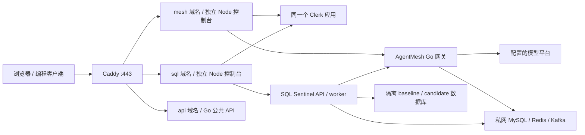

# 双控制台上线方案与操作顺序

目标：同一 Linux 云服务器、Docker Compose、三个 HTTPS 域名；两个独立产品，共用一个 Clerk 生产应用，各自管理授权。本文为当前 Web 版本的部署入口；原后端配置、计费、备份和恢复流程继续适用。源码可部署不等于真实域名、Clerk 或模型已经验收。

## 1. 拓扑与边界



- `mesh.你的域名`、`sql.你的域名`：独立构建、进程、私有挂载和产品成员文件。使用同一个父域名；本实现未接入不同根域的 Clerk satellite。
- `api.你的域名`：`/v1/*` 给网关应用 Key 调用；`/sentinel/*` 保留原服务 API。Caddy 公网入口阻断 `/admin/*`、`/sentinel/auth/*` 和 metrics。
- 平台管理通过网关控制台 BFF 的固定白名单转发，必须由私有成员文件明确设置 `platform_admin:true`；管理凭据不会进入浏览器。`can_manage_keys` 只管理当前租户应用 Key，不代表平台管理权限。
- SQL 的 admin/reviewer/writer/reader 继续由独立 scoped token 执行业务权限。项目凭据页只列元数据和撤销，不向浏览器提供 bootstrap 或自助跨项目签发。
- 新注册账号默认没有产品授权和模型额度。成员配置负责开通；不要以邮箱字符串自动合并账号。
- 图片为私有、有大小及保留期限制的资产，不提供公开无鉴权图床。知识文档的版本是当前版本替换，不是完整版本历史存储。

## 2. 需要准备的资料

| 资料 | 获取位置 / 用途 |
|---|---|
| Linux 主机与 SSH 管理方式 | 用户自己的云服务器；本次未创建或购买 |
| 三个同父域名的 DNS A/AAAA | 域名 DNS 控制台，指向服务器；公网只开放 80/443，SSH 按自己的管理策略限制 |
| Clerk 同一个 production application | [Clerk Dashboard](https://dashboard.clerk.com/) → API Keys：Publishable Key 与 Secret Key；Domains 完成生产域名/DNS设置 |
| Clerk Issuer | 同实例 Frontend API origin；必须与 Publishable Key 解码的域名一致 |
| Clerk 用户 ID | Dashboard → Users → 用户稳定 `user_...` ID；邮箱验证开启，不需要提供个人密码、身份证或邮箱密码 |
| 现有网关租户和专用应用 Key | 已有管理流程开通、充值后签发；控制台服务端私有保存 |
| 网关 admin token、SQL bootstrap | 后端 setup 生成的私有文件；不能粘贴到网页或公开仓库 |
| 模型 Base URL、可用模型和实际价格 | 自己模型账户的控制台与官方价格资料；沿用 QWEN-RUNBOOK，不盲目声明 tools/vision 能力 |

本轮没有要求传送私有密钥。Secret Key、模型 Key 均用文件提供。真实 Clerk 登录和邮件验证必须在拿到实例后核实；配置检查不能证明真实身份服务可用。

## 3. 目录与初始化

保持源码和部署目录同级，使用两个仓库当前 `master`，不把本机验收 `.env`、数据库卷或测试密钥复制到服务器：

```text
/srv/internship/
  AgentMesh/
  sql-sentinel/
  deploy/                 # 从 AgentMesh/deployments/backend-stack 复制模板
    .env                  # 后端私有配置
    secrets/              # 后端私有凭据
    console-private/
      mesh/               # 只挂载给 mesh-console
      sentinel/           # 只挂载给 sentinel-console
```

先按 `QWEN-RUNBOOK.md` 在全新目录运行后端 `setup.py`。如希望网页显示人民币账单，需要按手册启用 `qwen-billing.yml`、提供有效价格目录并完成管理充值；只有 token 预算的旧模式不能冒充人民币钱包。

在已经存在 compose.yml 与私有 .env 的 deploy 目录，使用以下生成器。将下方尖括号占位替换为真实值；示例不直接可运行。Linux 使用 root 或 UID 1000 执行，以保证文件只能由宿主授权身份和容器 UID 1000 读取：

```sh
sudo python3 console-setup.py --deploy-dir /srv/internship/deploy \
  --mesh-domain '<mesh真实域名>' --sentinel-domain '<sql真实域名>' --api-domain '<api真实域名>' \
  --clerk-publishable-key '<pk_live_公开Key>' --clerk-issuer 'https://<实例域名>' \
  --clerk-secret-file /secure/clerk-secret \
  --gateway-key-file /secure/console-gateway-key \
  --gateway-admin-file /srv/internship/deploy/secrets/admin_token \
  --sentinel-bootstrap-file /srv/internship/deploy/secrets/sentinel_token \
  --user-id '<user_稳定ID>' --tenant-id '<已有租户>' --project-id '<SQL项目>' \
  --tables orders --sql-role writer
```

需要平台管理员时显式加 `--platform-admin`。SQL 管理者显式选择 `--sql-role admin`；普通 writer 不能审批自己的任务。默认不赠送权限或费用。

生成器：验证两个生产 origin、Key/Issuer、作用域与私有文件后才开始写入；保留 `.env` 其他值，只更新三个域名；拒绝覆盖已有 console-private。维护已有部署时，备份后原子更新私有 JSON，不能反复运行初始化覆盖成员。两个产品的授权可以分别撤销。目录 0700，文件 0600，容器 UID 1000；不要为修权限改成 0777。

## 4. 构建、预检、启动

以下为千问 + 人民币账本组合；若部署使用其他已确认的覆盖文件，保留原组合。不要混入 `acceptance.yml`，也不要用新的简写替换正在运行的扩展拓扑。

```sh
cd /srv/internship/deploy
export COMPOSE_PROJECT_NAME=internship
export COMPOSE_FILE=compose.yml:qwen.yml:qwen-billing.yml:consoles.yml
docker compose config --quiet
docker compose build am-migrate ss-migrate proxy mesh-console sentinel-console
```

首次部署，按后端手册启动 control/baseline/candidate/Redis/Kafka、执行迁移与 topics，必要时仅对新隔离影子库 seed，再启动 Go API 与 worker。不要在已有库重复 seed。

前端预检使用真实 runtime 镜像、私有配置及内部业务 readyz，不调用模型：

```sh
docker compose run --rm --no-deps mesh-console node check-config.mjs --probe
docker compose run --rm --no-deps sentinel-console node check-config.mjs --probe
docker compose up -d mesh-console sentinel-console
docker compose up -d proxy
docker compose exec -T proxy caddy validate --config /etc/caddy/Caddyfile --adapter caddyfile
docker compose exec -T proxy caddy reload --config /etc/caddy/Caddyfile --adapter caddyfile
docker compose ps
```

`/healthz` 只代表 Node 进程。`/readyz` 检查身份配置/成员文件与 Go 就绪，不把它表述为真实 Clerk 邮件或模型调用通过。网页 `?preview=1` 明示样例，不能绕过真实服务端身份校验。

镜像非 root、根文件系统只读、私有挂载只读、能力删除、日志轮换、内存与 PID 上限沿用 consoles.yml。无数据库、管理端口或 Node 端口新增公网映射。根 `.dockerignore` 排除 node_modules/dist/console-private，避免 Go 镜像意外携带前端依赖或私有文件。

## 5. 首次上线的可观察结果

以下是未来真实环境验收条件，不能用本机模拟结果代替：

1. 三域 HTTPS 证书有效，两个控制台能加载资源并互相跳转；域名、Clerk production DNS 和实例一致。
2. 同一真实用户完成邮箱验证并能访问获准产品；移除一个产品成员映射后只拒绝该产品；未授权页面能退出和重新检查。
3. 网关目录/价格/余额读取成功，选实际模型完成一次有上限的文字调用；可选图片只在模型声明真实支持时调用；账单关联正确。
4. 下载 OpenCode/Claude 配置前通过当前工作空间预检；新签发应用 Key 用 `client-config.py` 单独验证，不将控制台专用 Key 的检查冒充所有 Key 的可用性。
5. SQL 提交 → 持久任务 → 报告；有权限的另一审阅者审批 → 创建测量任务；报告结论、测量值及事实与 JSON 一致。
6. 文档上传/列表/删除及 RAG 证据片段可核对；可选 ES/GitHub 未配置时明确显示缺项，不伪造“已联通”。
7. 管理员功能受权限限制；普通用户不能通过改 URL 访问；充值使用稳定 credit_id，超时先核对，不能换 ID 自动重试。

本轮不执行付费模型调用。真实生产 smoke 另设费用上限，逐步执行。服务价格过期、冻结账单、模型不支持 tools 或权限缺失都属于阻断信息，不能为演示隐藏。

## 6. 运维、升级与回退

- 初期采用单机 Compose，两个控制台保持独立。根据实际 CPU、常驻内存、磁盘及队列延迟决定后续扩容；影子库、Kafka 和可选 ES 占用需独立测量。此方案没有高可用承诺，单机故障会影响全部服务。
- 保留 `COMPOSE_FILE`、项目名、Git commit SHA 和镜像 ID；记录迁移执行结果。先备份，再滚动替换前端；后端升级按原手册停写/迁移，不自动删除卷或回滚 schema。
- 前端回退使用此前保存的源码 SHA/镜像，保持私有配置和原有卷；确认 API 契约兼容后切回。不要用覆盖生产秘密或删除账本的方式回退。
- `backup.sh` 备份数据库及私有图片数据；console-private 与其他 secrets 单独加密离机备份，恢复时保持成员及 UID 权限。备份中含 SQL、报告和图片，不能上传公开仓库。
- 首先关注 readyz、失败率、429、任务死信、待对账、价格有效期、磁盘和身份服务不可用。确认后再扩大流量；CI 通过不替代目标云网络验收。

本方案没有购买服务器、修改真实 DNS、注册 Clerk 账户、发布 Release 或创建 PR。GitHub 源码提交与实际云上线是两个不同结果。


## 本次安全与验证边界

Go 构建最低版本统一为 1.26.10，修复 [GO-2026-6809](https://pkg.go.dev/vuln/GO-2026-6809)，代理实际二进制 build-info 已核对。两个业务模块的源码可达性扫描未发现漏洞。代理的符号/导入包扫描为 0；模块全量枚举仍报告 [GO-2026-5932](https://pkg.go.dev/vuln/GO-2026-5932)，涉及未维护的 x/crypto/openpgp，该包没有被当前代理导入，官方也没有该包的修复版本。没有删除告警或将模块级结果伪装成全零；以后新增导入仍须重新扫描。未完成全部基础镜像 OS 软件包的 CVE 审计。
