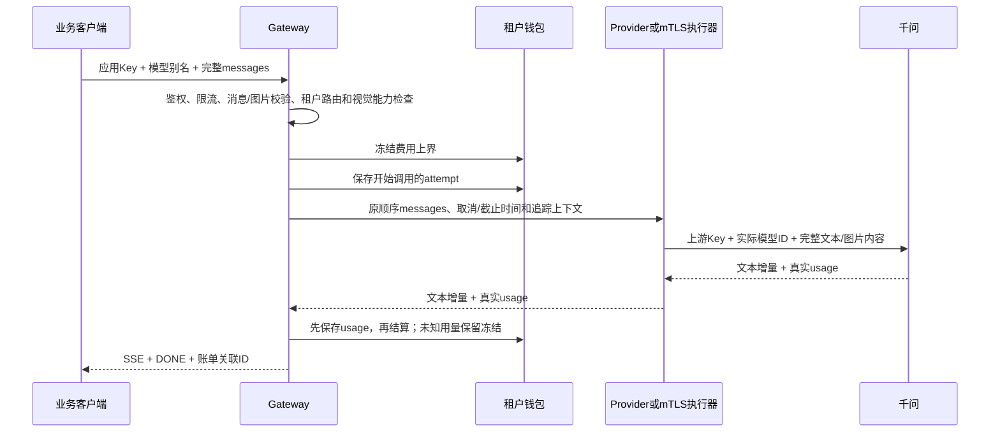

# 网关协议、上下文与图片：实现和学习说明

2026-10-16 更新：用户随后明确要求实际测试 OpenCode 与 Claude Code，已补齐工具循环和 Messages 转换，并完成两个真实 CLI 的千问 Read 往返。当前用法与限制见 [客户端接入](client-integration.md)。本文下方六项原设计已落实；公网部署、音视频、网关自动执行工具、服务端对话记忆与上下文压缩仍不在本轮范围。

## 一次调用内部发生什么



网关把用户 Key 解析成租户身份，百炼调用使用服务端的上游 Key。两种 Key 独立。租户/权限由服务端确定，不信任客户端伪造的 tenant_id 或供应商模型 ID。上下文不是把所有 HTTP Header 原样转发。

## 三种容易混淆的上下文

| 上下文 | 谁管理 | 本轮行为 |
|---|---|---|
| 模型对话 messages | 客户端 | 每次携带完整需要的历史，保留 system/user/assistant/developer 角色、消息和内容段顺序；上游对角色的支持仍取决于模型 |
| Go context | 网关及下游 | 传递取消、截止时间、服务端租户身份；客户端断开后停止生成，计费清理用独立有界 context 完成 |
| 追踪上下文 | HTTP/gRPC instrumentation | 继续已有 traceparent/tracestate 传播；日志和 trace 摘要不记录图片、历史正文或 Key |

网关不把不同请求拼成一段共享历史，也不会自动回忆上一轮。第二轮若要引用上一张图，客户端须把包含图片的原 user 消息、上一轮 assistant 回答和本轮问题一起发送。此处“穿透”是有校验的完整消息传递，不是保存会话或无限加长上下文。

超过限制直接拒绝，不静默截断 system 指令、历史或图片。未来做截断/摘要时，应由客户端或明确的会话层控制，保持工具调用配对，并把摘要丢失信息的风险写入契约。

## 图片已实现的协议

保留字符串 content 的原有调用；新增 OpenAI 风格内容数组：

```json
{
  "model": "domestic-chat",
  "messages": [
    {"role": "system", "content": "用中文描述实际看到的内容。"},
    {"role": "user", "content": [
      {"type": "text", "text": "图里有什么？"},
      {"type": "image_url", "image_url": {
        "url": "https://your-public-cdn.example/photo.jpg",
        "detail": "auto"
      }}
    ]}
  ],
  "stream": true,
  "max_tokens": 256
}
```

`url` 也可为 `data:image/png;base64,...` 或 `data:image/jpeg;base64,...`，省略号必须换成完整、规范 Base64。客户端读取自己的本地文件并编码；网关不读取用户提供的本地文件路径。

当前界限：HTTP JSON 最多 2 MiB，最多 128 条消息、每条最多 32 个内容段、整个历史最多 3 张图片。每张内嵌图解码最多 256 KiB、宽高各不超过 2048；验证 PNG/JPEG 格式头和声明类型，不执行全图像素解码或转码。未知媒体类型、音视频段、错误 Base64、图片 MIME 不匹配和无效角色在调用前拒绝。图片只允许出现在 user 内容中。

HTTPS URL 限 4096 字节、无用户密码、无 fragment、只允许默认/443 端口，拒绝本机、已知内部域名和私网 IP 字面量。网关不下载 URL、不跟随图片重定向、不执行 DNS 探测；图片由模型平台读取。该校验不是对供应商网络策略、DNS 重绑定、远端图片大小或可访问性的证明。内嵌图片有更可控的大小和内容。

模型需显式声明视觉能力：

```dotenv
COMPATIBLE_MODELS='{"domestic-chat":"qwen3.8-omni-flash","sql-review":"qwen3.8-omni-flash"}'
COMPATIBLE_VISION_MODELS='["domestic-chat"]'
```

别名必须已存在于实际模型映射，错误/重复声明拒绝启动。空声明保持原纯文本行为。网关在钱包冻结前检查路由视觉能力；Router 在开始 attempt 前跳过不支持图片的适配器，不把多模态消息降级成缺图文本。未知/无权限模型仍按原规则拒绝。

新部署 `setup.py --chat-provider qwen ... --qwen-model qwen3.8-omni-flash --qwen-vision` 可生成配置，普通 token 预算预留同步设为 65536；已有部署不会被 setup 自动覆写，须显式更新环境并重建服务。人民币计费仍需有效价格目录和钱包余额。mTLS 模式需 gateway/model-runner 两侧一致配置视觉别名；服务端再次检查能力、租户路由与实际模型绑定。仅 ModelRunner 的请求传输上限扩大到 2 MiB 加封装余量，其他默认 gRPC 服务仍为 128 KiB；响应单帧和总量上限保持原值。

## 计费和缓存为何也要改

Base64 的字节数不是模型输入 token 数。钱包的 admission 使用文本字节/封装加每图 16384 的保守输入 allowance，整个请求上界仍为 65536；allowance 只控制准入，不写入真实 usage 或伪造扣款。它针对当前千问视觉协议的有界图片输入，换平台前须重新核实模型上限、图片 token 规则和价格。

实际扣费只使用供应商 usage 中的总输入、缓存输入、输出 token。图片输入费用包含在真实 prompt_tokens 中，不能按图片张数计费，也不能按 Base64 长度扣费。没有真实可信 usage 时保留 pending_reconciliation。

现有语义缓存基于文本向量；任意历史消息包含内容数组即绕过此缓存，避免图片不同却因问题文本相同命中旧答案。供应商自身的 prompt cache 仍按真实 cached token 回执结算，两者不是同一种缓存。

## OpenCode 工具循环：原设计与当前实现

OpenCode 配置为自定义 Chat Completions Provider，Base URL 指向网关 `/v1`，凭据使用租户 Key，模型使用公开别名。现提供只读接入检查与配置生成器，已在 1.19.0 实测；Claude Code 2.1.234 使用网关根 URL 的 Messages 入口。

以下是 2026-10-15 的设计要求，现已实现，并有对应回归与实际 Read 测试：

1. 请求 DTO：有界 tools/function JSON Schema、tool_choice、parallel_tool_calls；消息增加 assistant.tool_calls、tool.tool_call_id，允许工具调用时 content=null。不得用 map 任意放行所有未知参数。
2. 历史验证：工具调用 ID、函数名和执行结果严格关联，保留多轮消息顺序。网关不执行工具、不把工具结果当 system 指令，也不自动插入、合并或摘要这些消息。
3. 流式 DTO：ToolCallDelta 按 index/id 累积，参数是可分片 JSON 字符串，不能逐片当完整 JSON 解析；原样转发受限增量，结束原因区分 stop/length/tool_calls。任意工具增量输出后必须禁止 fallback，避免重复工具调用。
4. 计费：工具定义/历史参与输入上界；工具参数增量参与输出预算和反压，真实 token 仍从供应商 usage 取得。tools/图片/多轮工具上下文默认不使用现有文本缓存。
5. 客户端循环：模型发出工具调用→OpenCode 在本机按自己的权限读取/编辑/执行→把结果作为 tool 消息回传→下一轮生成。网关负责鉴权、路由、协议、预算和观测，客户端负责工具权限与循环。
6. 验收：工具参数多片重组、多个调用交错、取消、usage 丢失、非法 ID/Schema、输出后断流及防重复扣费，再进行具体客户端版本联调。

当前 tools/tool_calls 已作为有界类型接受，图片和工具请求绕过文本缓存；尚未支持的协议功能仍明确拒绝。真实客户端验收范围是 Read 工具往返，不等同所有编程功能或所有版本兼容。

## 代码阅读顺序

1. `internal/provider/message.go`：content 字符串/数组的编解码、图片与上下文边界。
2. `internal/gateway/server.go`：认证后解码、租户路由、能力检查、冻结及流式返回。
3. `internal/router/router.go`：开始 attempt 前的能力筛选、首输出后禁止 fallback。
4. `internal/provider/ark/ark.go`：别名映射实际模型，完整 messages 发给千问，提取回答与真实 usage。
5. `internal/modelrpc/service.go`：JSON 消息跨 mTLS、服务端再次授权及取消传播。
6. `internal/billing/store.go`、`internal/reservation/coordinator.go`：金额与旧预算体系各自的冻结/实际用量/恢复；两者单位不同。
7. `internal/semanticcache/cache.go`：图片上下文绕过文本缓存。

官方依据（核实于 2026-10-15）：[Qwen3.8 Omni Flash 能力](https://help.aliyun.com/en/model-studio/qwen3-8-omni-flash)、[图像与视频理解及 Base64 示例](https://help.aliyun.com/zh/model-studio/vision)、[OpenCode 自定义 Provider](https://opencode.ai/docs/providers/)、[OpenCode 工具](https://opencode.ai/docs/tools/)。
